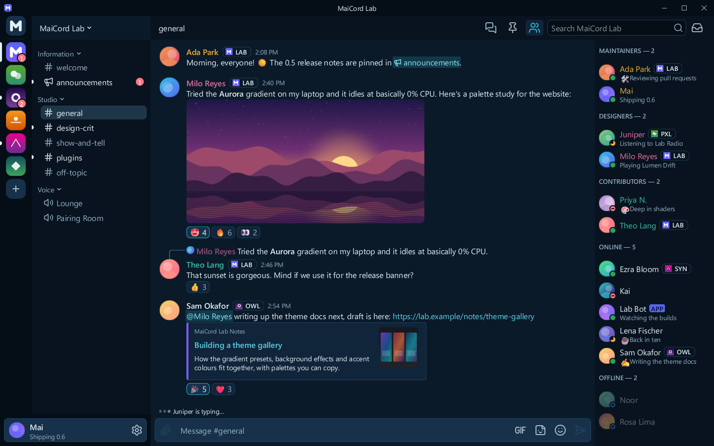

# Deep Ocean

A deep navy dark theme with a cool teal accent.

| | |
|---|---|
| Author | MaiCord |
| License | CC0-1.0 |
| Kind | Theme |
| Base | Dark |
| File | [`theme.json`](theme.json) |

Navy surfaces step up from near-black at the server rail to a blue-grey composer, and a bright teal accent carries links, mentions and the selection. Text on accent buttons is dark navy, not white, because white on this teal would not reach 4.5:1.

## Colours

| Role | Colour |
|---|---|
| Chat background | `#0b1a29` |
| Sidebar and member list | `#08131f` |
| Server rail and caption | `#050d16` |
| Cards and embeds | `#10253a` |
| Composer and inputs | `#163149` |
| Controls | `#1f4260` |
| Controls, hovered | `#29557a` |
| Text | `#e4f1f8` |
| Muted text | `#95b2c6` |
| Accent | `#22b8cf` |
| Text on accent | `#031018` |
| Links | `#5fd3e6` |
| Notifications | `#ff7686` |

## Contrast

Measured against the chat, sidebar, card and input backgrounds (the worst case of the four), with MaiCord's own theme maths:

| Pair | Ratio | Target |
|---|---|---|
| Text | 11.6:1 | 4.5:1 |
| Muted text | 6.0:1 | 4.5:1 |
| Links | 7.6:1 | 4.5:1 |
| Danger, positive and warning text | 5.2:1 | 4.5:1 |
| Text on accent | 8.1:1 | 4.5:1 |
| Code colours | 7.6:1 | 4.5:1 |

This theme meets WCAG AA for text, and MaiCord reports no contrast warnings for it.

## Install

Once the catalog lists themes, install it from MaiCord's Browse tab. Until then, download [`theme.json`](theme.json) and choose **Settings > Appearance > Import theme…**.
