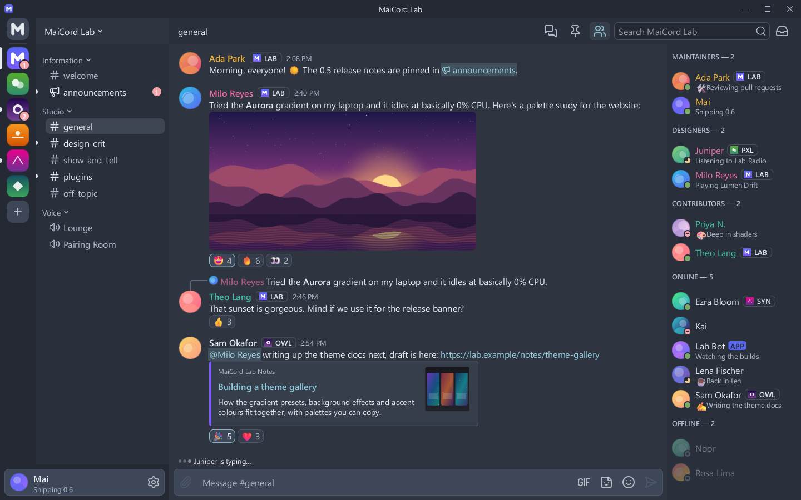

# Fjord

A muted, frosty blue-grey dark theme in the spirit of the Nord palette.

| | |
|---|---|
| Author | MaiCord |
| License | MIT |
| Kind | Theme |
| Base | Dark |
| File | [`theme.json`](theme.json) |

Muted blue-greys and a frosty cyan accent in the spirit of the Nord palette: low saturation, gentle contrast, and a pastel red for notifications so they stay readable on the grey surfaces.

## Colours

| Role | Colour |
|---|---|
| Chat background | `#2e3440` |
| Sidebar and member list | `#2a303b` |
| Server rail and caption | `#242933` |
| Cards and embeds | `#363d4b` |
| Composer and inputs | `#3e4757` |
| Controls | `#4c566a` |
| Controls, hovered | `#5b677e` |
| Text | `#e5e9f0` |
| Muted text | `#b3bdcf` |
| Accent | `#88c0d0` |
| Text on accent | `#232830` |
| Links | `#8fcbdc` |
| Notifications | `#f6a3aa` |

## Contrast

Measured against the chat, sidebar, card and input backgrounds (the worst case of the four), with MaiCord's own theme maths:

| Pair | Ratio | Target |
|---|---|---|
| Text | 7.7:1 | 4.5:1 |
| Muted text | 4.9:1 | 4.5:1 |
| Links | 5.2:1 | 4.5:1 |
| Danger, positive and warning text | 4.6:1 | 4.5:1 |
| Text on accent | 7.4:1 | 4.5:1 |
| Code colours | 4.6:1 | 4.5:1 |

This theme meets WCAG AA for text, and MaiCord reports no contrast warnings for it.

## Install

Once the catalog lists themes, install it from MaiCord's Browse tab. Until then, download [`theme.json`](theme.json) and choose **Settings > Appearance > Import theme…**.

## Credits

The colours follow the [Nord](https://www.nordtheme.com) palette, MIT licensed, Copyright (c) 2016-present Sven Greb. No Nord files are used.
