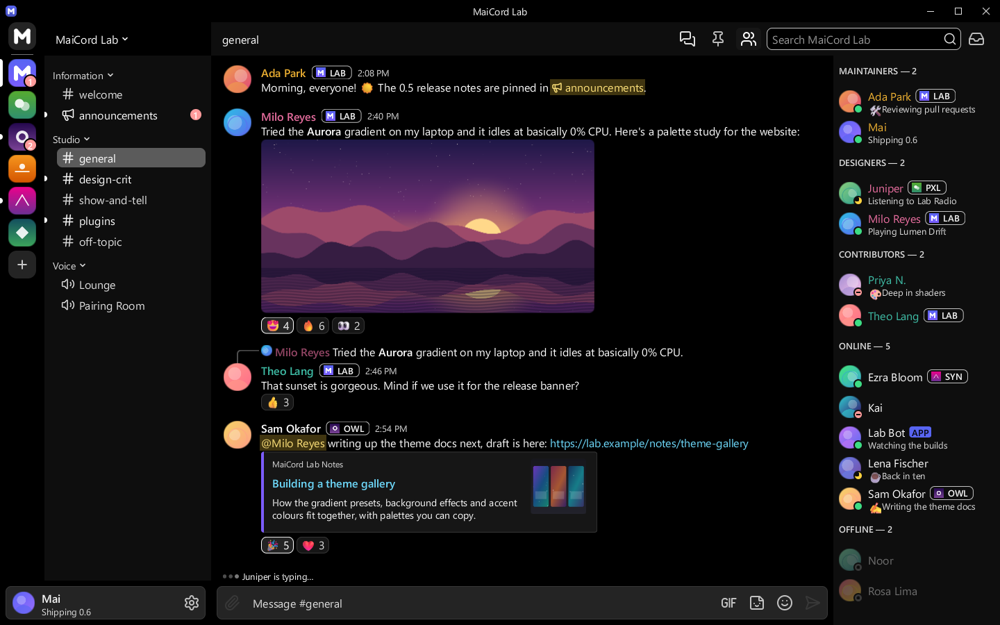

# High Contrast

Pure black and white with a yellow accent, strong borders and heavier icons. Passes WCAG AAA for text.

| | |
|---|---|
| Author | MaiCord |
| License | CC0-1.0 |
| Kind | Theme |
| Base | Dark |
| File | [`theme.json`](theme.json) |

Pure black and white text on black, a yellow accent with black labels, bright borders, brighter hover and selection states and heavier icons (1.5 stroke weight). Text, muted text, links, status text and accent labels all pass WCAG AAA (7:1). Unlike the built-in AMOLED theme, it uses bright borders and a slightly raised sidebar.

## Colours

| Role | Colour |
|---|---|
| Chat background | `#000000` |
| Sidebar and member list | `#0e0e0e` |
| Server rail and caption | `#000000` |
| Cards and embeds | `#161616` |
| Composer and inputs | `#242424` |
| Controls | `#383838` |
| Controls, hovered | `#4d4d4d` |
| Text | `#ffffff` |
| Muted text | `#e0e0e0` |
| Accent | `#ffd23f` |
| Text on accent | `#000000` |
| Links | `#6fdcff` |
| Notifications | `#ff9b9b` |

## Contrast

Measured against the chat, sidebar, card and input backgrounds (the worst case of the four), with MaiCord's own theme maths:

| Pair | Ratio | Target |
|---|---|---|
| Text | 15.5:1 | 7.0:1 |
| Muted text | 11.8:1 | 7.0:1 |
| Links | 9.9:1 | 7.0:1 |
| Danger, positive and warning text | 7.7:1 | 7.0:1 |
| Text on accent | 14.5:1 | 7.0:1 |
| Code colours | 10.4:1 | 4.5:1 |

This theme meets WCAG AAA for text, and MaiCord reports no contrast warnings for it.

## Install

Once the catalog lists themes, install it from MaiCord's Browse tab. Until then, download [`theme.json`](theme.json) and choose **Settings > Appearance > Import theme…**.
