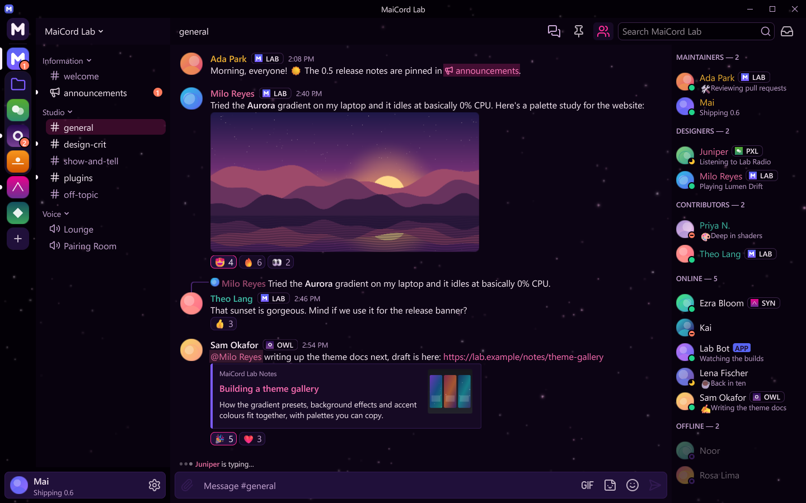

# Neon Grid

Deep violet-black surfaces, a hot-pink accent and a faint drift of stars.

| | |
|---|---|
| Author | MaiCord |
| License | CC0-1.0 |
| Kind | Theme |
| Base | Dark |
| Effect | [Starfield](../../effects/starfield/details.md), subtle |
| File | [`theme.json`](theme.json) |

Violet-black surfaces step up from near-black at the server rail to a deep purple composer, with lilac-tinted borders and hover states. A hot-pink accent carries links, mentions, the selected channel and focus rings, and its labels are near-black because white on this pink would not reach 4.5:1. Orange-red marks notifications so they stay apart from the accent. It differs from the built-in AMOLED and from Obsidian by its purple-black base, its pink accent and its stars.

## Background effect

The theme asks for the [Starfield](../../effects/starfield/details.md) effect at a subtle setting: sparse, small stars drifting slowly at 60% opacity, which MaiCord applies when Starfield is installed (installing the theme offers it). Without the effect the theme is flat.

The settings are in `theme.json`: `density` 0.07, `speed` 0.35, `size` 1.0, `twinkle` 0.7 and opacity 60%. Change them under Settings > Appearance > Background effect.

## Colours

| Role | Colour |
|---|---|
| Chat background | `#0c0414` |
| Sidebar and member list | `#08020e` |
| Server rail and caption | `#030006` |
| Cards and embeds | `#160a24` |
| Composer and inputs | `#20103a` |
| Controls | `#321a52` |
| Controls, hovered | `#482570` |
| Text | `#fdf0fa` |
| Muted text | `#c9a9d6` |
| Accent | `#ff2e97` |
| Text on accent | `#14000c` |
| Links | `#ff6fb5` |
| Notifications | `#ff7a5c` |

## Contrast

Measured against the chat, sidebar, card and input backgrounds (the worst case of the four), with MaiCord's own theme maths:

| Pair | Ratio | Target |
|---|---|---|
| Text | 15.9:1 | 4.5:1 |
| Muted text | 8.5:1 | 4.5:1 |
| Links | 6.8:1 | 4.5:1 |
| Danger, positive and warning text | 6.8:1 | 4.5:1 |
| Text on accent | 5.9:1 | 4.5:1 |
| Code colours | 7.7:1 | 4.5:1 |

This theme meets WCAG AA for text, and MaiCord reports no contrast warnings for it.

## Install

Install it from MaiCord's Themes page, or download [`theme.json`](theme.json) and choose **Settings > Appearance > Import theme…**.
