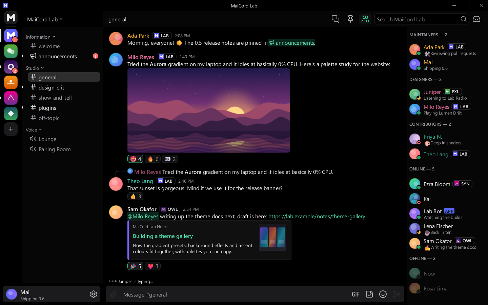

# Obsidian

True black chat and surfaces for OLED panels, with neutral greys and an emerald accent.

| | |
|---|---|
| Author | MaiCord |
| License | CC0-1.0 |
| Kind | Theme |
| Base | Dark |
| File | [`theme.json`](theme.json) |

The chat area and server rail are true black (#000000) so OLED pixels switch off, while the sidebar, cards and composer step up through near-black neutral greys. An emerald accent with dark labels sets it apart from the built-in AMOLED, which keeps the blurple accent.

## Colours

| Role | Colour |
|---|---|
| Chat background | `#000000` |
| Sidebar and member list | `#060606` |
| Server rail and caption | `#000000` |
| Cards and embeds | `#101011` |
| Composer and inputs | `#1b1b1d` |
| Controls | `#2a2a2d` |
| Controls, hovered | `#3a3a3e` |
| Text | `#ececee` |
| Muted text | `#9d9da4` |
| Accent | `#34d399` |
| Text on accent | `#03150d` |
| Links | `#4fe0aa` |
| Notifications | `#ff6b6b` |

## Contrast

Measured against the chat, sidebar, card and input backgrounds (the worst case of the four), with MaiCord's own theme maths:

| Pair | Ratio | Target |
|---|---|---|
| Text | 14.6:1 | 4.5:1 |
| Muted text | 6.4:1 | 4.5:1 |
| Links | 10.3:1 | 4.5:1 |
| Danger, positive and warning text | 6.2:1 | 4.5:1 |
| Text on accent | 9.8:1 | 4.5:1 |
| Code colours | 9.5:1 | 4.5:1 |

This theme meets WCAG AA for text, and MaiCord reports no contrast warnings for it.

## Install

Once the catalog lists themes, install it from MaiCord's Browse tab. Until then, download [`theme.json`](theme.json) and choose **Settings > Appearance > Import theme…**.
