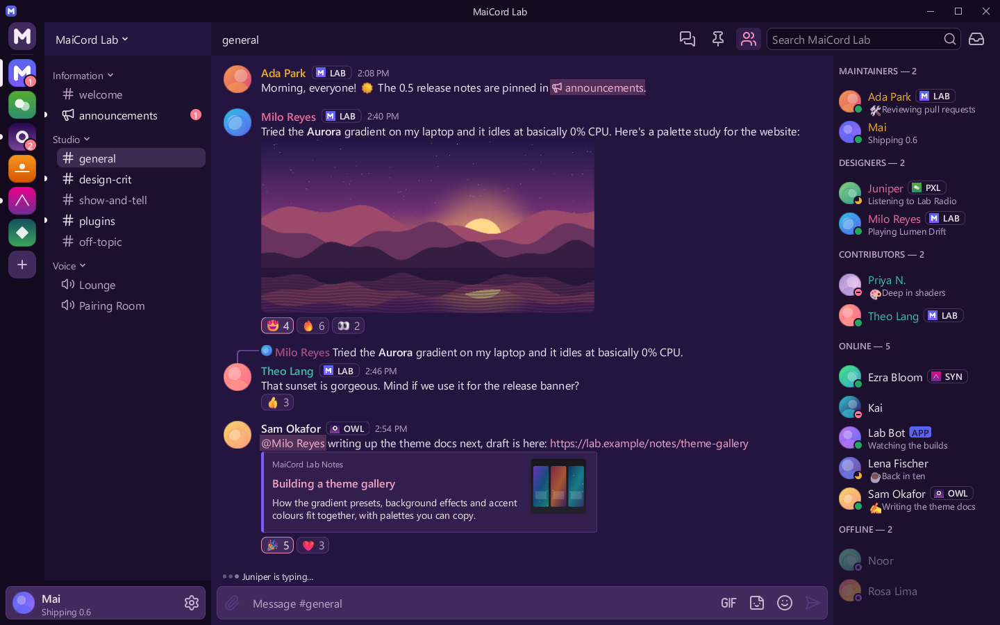

# Rose Dusk

Deep plum surfaces with a soft rose accent, like the sky just after sunset.

| | |
|---|---|
| Author | MaiCord |
| License | CC0-1.0 |
| Kind | Theme |
| Base | Dark |
| File | [`theme.json`](theme.json) |

Deep plum surfaces, lilac-tinted borders and hover states, and a soft rose accent with dark labels. Code colours are pastel to match.

## Colours

| Role | Colour |
|---|---|
| Chat background | `#241540` |
| Sidebar and member list | `#1c102e` |
| Server rail and caption | `#140a20` |
| Cards and embeds | `#321f4d` |
| Composer and inputs | `#402a5e` |
| Controls | `#55397a` |
| Controls, hovered | `#694a93` |
| Text | `#f6ecf8` |
| Muted text | `#bfa8cc` |
| Accent | `#f08fb8` |
| Text on accent | `#2a0f22` |
| Links | `#f7a6c8` |
| Notifications | `#ff7a8f` |

## Contrast

Measured against the chat, sidebar, card and input backgrounds (the worst case of the four), with MaiCord's own theme maths:

| Pair | Ratio | Target |
|---|---|---|
| Text | 10.7:1 | 4.5:1 |
| Muted text | 5.7:1 | 4.5:1 |
| Links | 6.6:1 | 4.5:1 |
| Danger, positive and warning text | 4.9:1 | 4.5:1 |
| Text on accent | 7.8:1 | 4.5:1 |
| Code colours | 8.3:1 | 4.5:1 |

This theme meets WCAG AA for text, and MaiCord reports no contrast warnings for it.

## Install

Once the catalog lists themes, install it from MaiCord's Browse tab. Until then, download [`theme.json`](theme.json) and choose **Settings > Appearance > Import theme…**.
