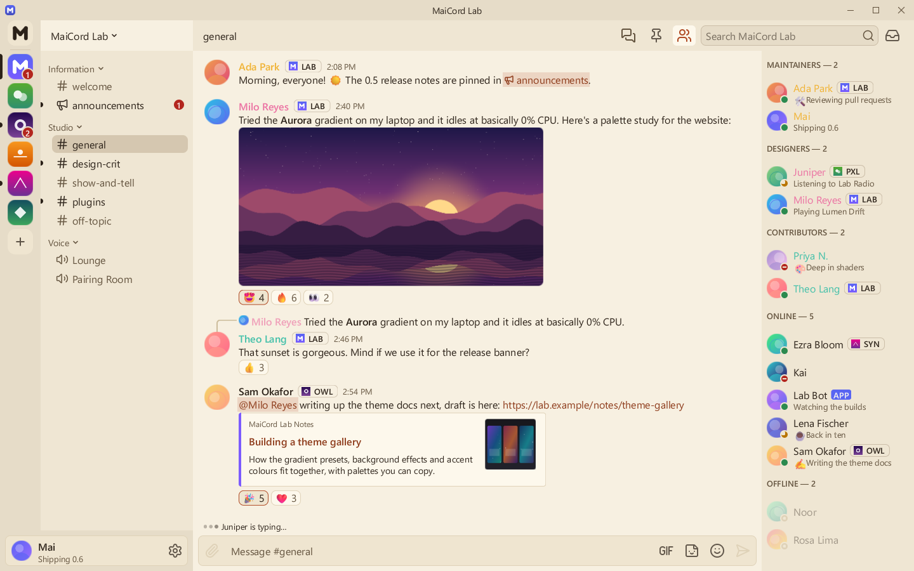

# Warm Paper

A warm, cream-coloured light theme with a terracotta accent, easy on the eyes.

| | |
|---|---|
| Author | MaiCord |
| License | CC0-1.0 |
| Kind | Theme |
| Base | Light |
| File | [`theme.json`](theme.json) |

A light theme without the blue cast of the built-in Light: cream surfaces, brown-black text and a terracotta accent. The status colours, links and code colours are darker than the defaults so they stay readable on cream.

## Colours

| Role | Colour |
|---|---|
| Chat background | `#f7f0e1` |
| Sidebar and member list | `#efe6d3` |
| Server rail and caption | `#e6dcc8` |
| Cards and embeds | `#fdf8ec` |
| Composer and inputs | `#efe5d0` |
| Controls | `#dfd2b8` |
| Controls, hovered | `#cdbd9c` |
| Text | `#2b2118` |
| Muted text | `#62523d` |
| Accent | `#b04a24` |
| Text on accent | `#fffaf0` |
| Links | `#9a3e1a` |
| Notifications | `#b3261e` |

## Contrast

Measured against the chat, sidebar, card and input backgrounds (the worst case of the four), with MaiCord's own theme maths:

| Pair | Ratio | Target |
|---|---|---|
| Text | 12.6:1 | 4.5:1 |
| Muted text | 6.0:1 | 4.5:1 |
| Links | 5.5:1 | 4.5:1 |
| Danger, positive and warning text | 5.2:1 | 4.5:1 |
| Text on accent | 5.2:1 | 4.5:1 |
| Code colours | 5.0:1 | 4.5:1 |

This theme meets WCAG AA for text, and MaiCord reports no contrast warnings for it.

## Install

Once the catalog lists themes, install it from MaiCord's Browse tab. Until then, download [`theme.json`](theme.json) and choose **Settings > Appearance > Import theme…**.
